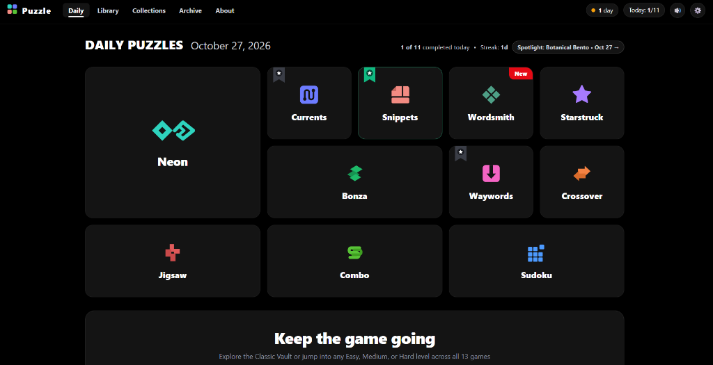
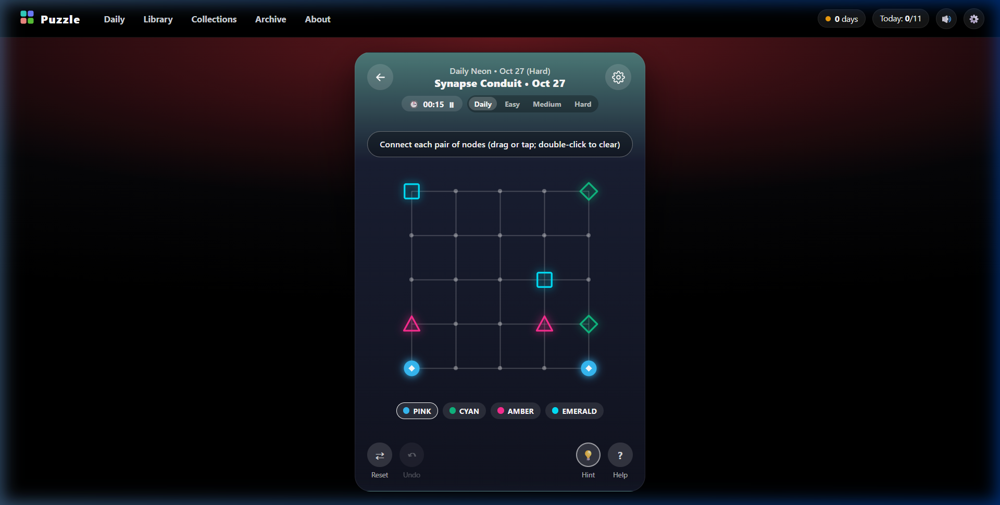
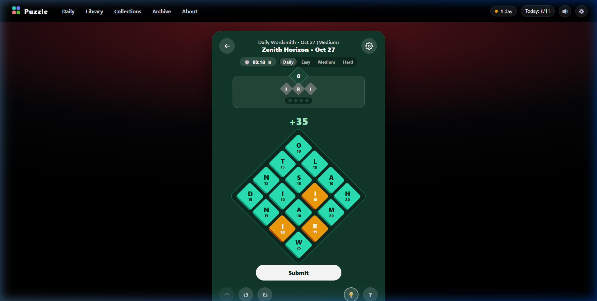
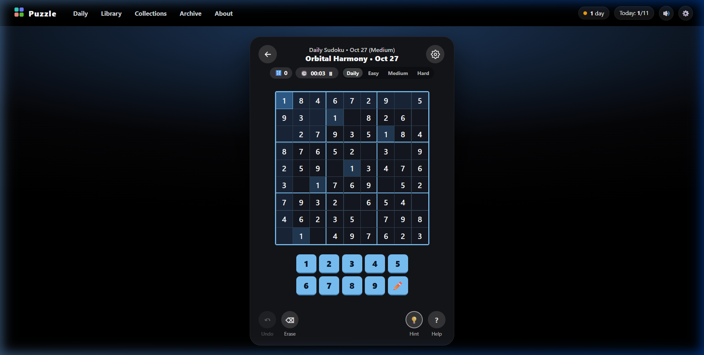
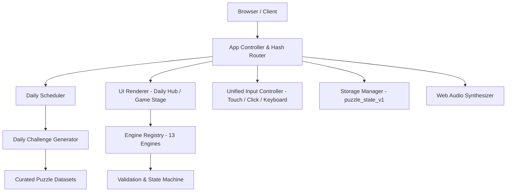

# Puzzle

**A daily puzzle and brain-training game collection featuring logic, words, numbers, patterns, spatial reasoning, and other puzzle challenges.**

Created by **Arpit Mishra**, Puzzle is a responsive, standalone web application that offers a distraction-free daily puzzle routine. Players can explore a diverse catalog of classic and modern puzzle genres, solve date-seeded daily challenges, switch freely between difficulty levels, and track streaks and game completion—all within a private, local-first browser environment.

---

## Dashboard Preview


*The Puzzle daily dashboard, displaying today's 11-game bento grid, daily completion tracker (`Today: 1/11`), consecutive streak indicator, and quick links to the full Library and Classic Vault.*

### Gameplay Previews

| Neon (Spatial Flow & Topology) | Wordsmith (8-Way Lexical Search) | Sudoku (Latin Square Deduction) |
| :---: | :---: | :---: |
|  |  |  |
| *Connecting color pairs with continuous wires* | *Forging words in 8 directions with tile point values* | *Candidate pencil notes & Latin square deduction* |

---

## Table of Contents

- [Project Overview](#project-overview)
- [Features](#features)
- [Games Included](#games-included)
- [Daily Puzzle System](#daily-puzzle-system)
- [Difficulty System](#difficulty-system)
- [Technology Stack & Architecture](#technology-stack--architecture)
- [Development Methodology & AI Assistance](#development-methodology--ai-assistance)
- [Getting Started](#getting-started)
- [Project Structure](#project-structure)
- [Testing & Build](#testing--build)
- [Deployment](#deployment)
- [Roadmap](#roadmap)
- [Privacy & Data](#privacy--data)
- [Limitations & Contribution](#limitations--contribution)
- [Acknowledgments & Disclaimer](#acknowledgments--disclaimer)

---

## Project Overview

Daily puzzle games have become a popular mental workout, but players frequently encounter aggressive paywalls, mandatory user registrations, ad interruptions, and privacy-invasive tracking. 

**Puzzle** addresses this by providing a unified, premium daily puzzle collection delivered directly to the browser. Designed for both casual daily players and dedicated logic and word puzzle fans, Puzzle offers:
- **Immediate Playability:** Launch any puzzle with a single click—no accounts, logins, or onboarding hurdles.
- **Unified Aesthetic:** A cohesive dark-themed studio interface featuring responsive phone-card staging, intuitive controls, and tactile Web Audio feedback.
- **Deterministic Variety:** 11 distinct daily puzzle categories refreshed every midnight, alongside 2 Classic Vault titles.

---

## Features

### Available Features
- **13 Independent Puzzle Engines:** 11 daily catalog categories and 2 classic vault titles with distinct mathematical rules, input handlers, conflict detectors, and win conditions.
- **Deterministic Date-Seeded Daily Challenges:** Every calendar date seeds a validated daily puzzle lineup with an automated spotlight game.
- **Casual & Advanced Difficulty Tiers:** In-game switcher allows toggling between **Daily**, **Easy**, **Medium**, and **Hard** challenges without corrupting daily progress.
- **Local-First Progress Persistence:** Auto-saves completed puzzles, streaks, active session drafts, and preferences to `localStorage` (`puzzle_state_v1`) with automatic migration from legacy schema (`puzzled_state_v1`).
- **Zero-Flicker Fluid Interaction:** Optimized DOM rendering eliminates screen blinking on state changes and touch-tap highlight flashes on mobile devices.
- **Dual Visual Themes:** Dark obsidian and light theme options (`data-theme="dark"` / `data-theme="light"`).
- **Responsive Layout:** Adaptive desktop bento layout transitions smoothly into a centered mobile phone-card view.
- **Synthesized Audio & Haptics:** Zero-dependency Web Audio API sound effects for taps, errors, and victories, paired with optional vibration feedback.
- **Progressive Hint & Error Detection:** Contextual hints, mistake counters, move timers, and full undo/reset stacks.
- **PWA & Offline Readiness:** Service Worker caching (`sw.js`) and web app manifest (`manifest.webmanifest`) enable offline play.
- **Spoiler-Free Sharing:** Generates emoji victory grids for social sharing.

### Planned Features
- Expanded standalone TypeScript test harness for all 13 puzzle engines.
- Archive calendar for replaying historical daily challenges.
- Cloud synchronization and JSON profile export/import.
- Packaged native mobile builds via Capacitor.

---

## Games Included

Puzzle features **13 playable game engines** categorized into an **11-Game Active Daily Lineup** and a **2-Game Classic Vault**:

### Active Daily Collection (11 Games)

| Game | Cognitive Domain | Core Mechanic & Rules |
| :--- | :--- | :--- |
| **Neon** | Spatial Flow & Topology | Connect matching colored symbol pairs on a grid with continuous orthogonal wires. Paths cannot cross or overlap other wires or terminals. |
| **Currents** | Hamiltonian Pathfinding | Trace a single unbroken stream through every non-blocked cell in the grid, visiting numbered waypoints in strict ascending order (`1..K`). |
| **Snippets** | Geometric Area Partition | Expand numbered clues into non-overlapping rectangles where `width × height` equals the clue value, covering 100% of the grid (Shikaku logic). |
| **Wordsmith** | 8-Way Lexical Search | Trace adjacent letter tiles horizontally, vertically, or diagonally to forge target words for tile points and length bonuses. Includes a board rotation tool. |
| **Starstruck** | Deductive Constraint Logic | Place exactly 1 star per row, column, and colored region on an $N \times N$ grid, ensuring no two stars touch—even diagonally (Star Battle rules). |
| **Bonza** | Lexical Chunk Assembly | Slide and arrange multi-letter word fragments on an open grid so all crossing words intersect around a central theme. |
| **Waywords** | Spatial Word Pathfinding | Connect adjacent letters to spell theme words that form a continuous bridge from the bottom launchpad row to the top goal row. |
| **Crossover** | Crossword Deduction | Solve interlocking Across and Down clues on a compact mini-crossword grid. |
| **Jigsaw** | Visual-Spatial Assembly | Select polyomino picture fragments from the tray and place them into their target coordinates to reassemble the illustration. |
| **Combo** | Compound Word Chaining | Solve an interconnected chain of compound words or two-word phrases where each second word forms the prefix of the next, guided by letter feedback. |
| **Sudoku** | Latin Square Deduction | Fill empty cells with digits so each row, column, and sub-box contains unique digits, supported by candidate pencil notes. |

### Classic Vault Collection (2 Games)

| Game | Cognitive Domain | Core Mechanic & Rules |
| :--- | :--- | :--- |
| **Shapes** | Polyomino Packing | Rotate and arrange geometric polyomino blocks to completely tile a target silhouette without overlap or gaps. |
| **Keysmash** | Lexical Reconstruction | Restore stripped vowels (`A, E, I, O, U`) into consonant skeletons to reconstruct themed words. |

---

## Daily Puzzle System

Puzzle generates a stable, fresh puzzle set for every calendar day based on local device date (`YYYY-MM-DD`):

1. **Deterministic Selection:** The daily date string is hashed to seed challenge parameters. Puzzles remain identical throughout that day for every player.
2. **Mathematical Transformations:** Date-seeded generation uses a Mulberry32 pseudorandom algorithm to apply dihedral board symmetries, row/column permutations, symbol relabeling, and tile derangements.
3. **Featured Spotlight:** Each day, one of the 11 active daily games is highlighted on the dashboard as the Daily Spotlight.
4. **Streak & Completion Tracking:** Completing daily challenges increments the daily counter (`Today: X/11`). Solving at least one daily puzzle preserves the consecutive day streak.

---

## Difficulty System

Every game supports three progressive difficulty modes in addition to the daily challenge:

- **Easy:** Smaller grid dimensions, fewer colors or waypoints, simpler vocabulary, and generous clues. Ideal for quick sessions.
- **Medium:** Standard challenge complexity, requiring multi-step deductions, tighter constraints, and longer word paths.
- **Hard:** Maximum grid sizes, intricate branching paths, complex constraint overlaps, and demanding spatial or vocabulary requirements.

Players can switch between **Daily**, **Easy**, **Medium**, and **Hard** at any time using the in-game header pill controls.

---

## Technology Stack & Architecture

### Stack
- **Core:** Vanilla JavaScript (ES2022) & TypeScript
- **Styling:** Custom Vanilla CSS with CSS custom properties (design tokens), radial horizon gradients, and responsive grid systems
- **Audio:** Web Audio API harmonic sound synthesizer (no external audio files required)
- **Bundler:** Webpack 5 with `@babel/core` & `@babel/preset-typescript`
- **Persistence:** LocalStorage API with an in-memory fallback for sandboxed iframes
- **Offline / PWA:** Service Worker (`dist/sw.js`) and Web App Manifest (`dist/manifest.webmanifest`)

### Architecture Overview



---

## Development Methodology & AI Assistance

Puzzle was developed through behavior-driven analysis of the publicly accessible web and mobile puzzle experience found in Netflix Puzzled (`tudum.com/puzzled`). The mechanics, constraint logic, and interface patterns were analyzed and independently implemented from scratch as a standalone web application.

- **AI-Assisted Development:** Code architecture, TypeScript state machines, mathematical puzzle generation, and styling implementation were developed using **Argon 4 powered by a Gemini model**, guided by project requirements from **Arpit Mishra**.
- **Independent Implementation:** All game engines, solver algorithms, UI components, sound synthesis, and daily generation logic are original implementations. No proprietary source code or assets were extracted or reused.

---

## Getting Started

### Prerequisites
- [Node.js](https://nodejs.org/) (v18.0.0 or higher recommended)
- `npm` (v9.0.0 or higher)

### Installation & Build

1. Clone the repository:
   ```bash
   git clone https://github.com/arpitmishra6567/puzzle.git
   cd puzzle
   ```

2. Install dependencies:
   ```bash
   npm install
   ```

3. Build the production application:
   ```bash
   npm run build
   ```

4. Preview locally using any static HTTP server:
   ```bash
   # Using npx serve:
   npx serve dist

   # Or using Python 3:
   python -m http.server --directory dist 8080
   ```
   Open `http://localhost:8080` (or the port displayed) in your browser. Alternatively, open [`dist/index.html`](dist/index.html) directly in any modern browser.

---

## Project Structure

```text
Puzzle/
├── dist/                       # Production web application bundle
│   ├── index.html              # Self-contained single-page application
│   ├── 404.html                # Custom 404 fallback page
│   ├── bundle.js               # Bundled JavaScript engine package
│   ├── icon.svg                # Vector application emblem
│   ├── manifest.webmanifest    # PWA web manifest
│   ├── robots.txt              # Search engine directives
│   ├── sitemap.xml             # XML sitemap
│   └── sw.js                   # Service Worker offline cache script
├── docs/                       # Project documentation & assets
│   ├── assets/                 # Genuine dashboard & gameplay screenshots
│   │   ├── puzzle-dashboard.png
│   │   ├── gameplay-neon.png
│   │   ├── gameplay-sudoku.png
│   │   └── gameplay-wordsmith.png
│   ├── architecture.md         # System architecture & storage migration
│   ├── game-specification.md   # Mathematical specifications for all 13 engines
│   ├── research-report.md      # Game analysis & catalog reconciliation report
│   └── testing-report.md       # Verification & test execution report
├── scripts/                    # Build and compilation tooling
│   ├── build-app.cjs           # Webpack packager & HTML generator
│   └── compile-ts.cjs          # Babel TypeScript compiler script
├── src/                        # Application source code
│   ├── data/                   # Puzzles, themes, and curated level banks
│   ├── engines/                # Core puzzle state machines and solvers
│   ├── lib/                    # Daily scheduler, audio synthesizer, storage
│   └── types/                  # TypeScript interfaces and game schemas
├── tests/                      # Automated test suites
│   ├── e2e/                    # Selenium Chromium multi-viewport visual test
│   └── unit/                   # Node.js engine and persistence unit tests
├── package.json                # Project dependencies and script definitions
├── tsconfig.json               # TypeScript compiler configuration
└── vercel.json                 # Vercel deployment configuration
```

---

## Testing & Build

| Script | Command | Purpose | Verified Status |
| :--- | :--- | :--- | :--- |
| **Type-check** | `npm run typecheck` | Compiles TypeScript files from `src/` to `build/` | **PASSING** (compiles cleanly) |
| **Build** | `npm run build` | Produces production `dist/index.html` & PWA assets | **PASSING** (clean exit code 0) |
| **Unit Tests** | `npm test` | Runs unit tests across engine state machines | **PENDING REFACTOR** (requires full module linkage) |
| **E2E Tests** | `npm run test:e2e` | Headless Chromium multi-viewport automation | Requires local Chromedriver setup |

---

## Deployment

The project is pre-configured for automated deployment on [Vercel](https://vercel.com/) via [`vercel.json`](vercel.json):

```json
{
  "version": 2,
  "buildCommand": "npm run build",
  "outputDirectory": "dist",
  "cleanUrls": true
}
```

### Deploying via GitHub to Vercel
1. Push your repository to GitHub: `https://github.com/arpitmishra6567/puzzle`
2. Navigate to [vercel.com/new](https://vercel.com/new) and select the `puzzle` repository.
3. Keep default settings (`buildCommand`: `npm run build`, `outputDirectory`: `dist`).
4. Click **Deploy**. Future pushes to `main` will trigger automatic builds.

---

## Roadmap

- [x] 13 deterministic puzzle engines with distinct rules, validations, and hints.
- [x] Date-seeded daily generator and daily spotlight scheduling.
- [x] In-game difficulty selector (Daily, Easy, Medium, Hard).
- [x] Screen blink removal and touch-tap highlight optimization.
- [x] Local storage persistence with automated schema migration.
- [x] PWA offline caching via Service Worker.
- [ ] Decouple remaining engine modules into standalone packages for full isolated unit-test execution.
- [ ] Calendar-based archive picker for browsing previous daily puzzles.
- [ ] Cross-device profile sync and manual JSON backup/restore.
- [ ] Mobile app packaging using Capacitor for Google Play and Apple App Store.

---

## Privacy & Data

- **Zero Remote Tracking:** Puzzle does not transmit personal data, gameplay metrics, or telemetry to external servers.
- **Local Storage Only:** Game progress, streaks, drafts, and preferences are stored exclusively on your device using `localStorage` (`puzzle_state_v1`).
- **User Data Ownership:** Players can reset all stored data at any time via **Settings > Reset Data**.
- **No Third-Party Cookies:** The application sets no cookies, ad trackers, or analytics scripts.

---

## Limitations & Contribution

### Known Limitations
- Unit tests (`npm test`) currently require module export realignment for isolated Node.js test execution.
- Sound effects rely on the browser's Web Audio API and may remain muted until the user first interacts with the page (per browser autoplay policies).

### Contributions
Contributions, bug reports, and puzzle design suggestions are welcome. Please open an issue or submit a pull request on [GitHub](https://github.com/arpitmishra6567/puzzle).

> **License Notice:** A formal open-source license file has not yet been selected. All rights are currently reserved by the author (**Arpit Mishra**) pending license selection.

---

## Acknowledgments & Disclaimer

- **Concept Inspiration:** Inspired by the user experience and design patterns of **Netflix Puzzled**.
- **AI Development:** Assisted by **Argon 4 (Gemini)** during technical analysis, state-machine formulation, and documentation structuring.
- **Disclaimer:** **Puzzle** is an independent, non-commercial game project created by **Arpit Mishra** for educational, engineering, and recreational purposes. It is **not** affiliated with, sponsored by, or endorsed by Netflix, Inc. All trademarks and registered trademarks belong to their respective owners.
