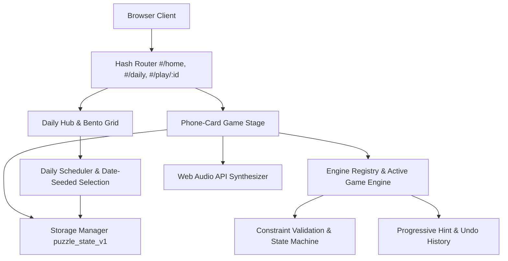

# Puzzle

**A daily puzzle and brain-training platform featuring logic, word, spatial, and number challenges.**

[](https://puzzle-view.vercel.app/)
[](package.json)
[](vercel.json)

Live Application: **[https://puzzle-view.vercel.app](https://puzzle-view.vercel.app/)**

Created by **Arpit Mishra**, Puzzle is an independently implemented, browser-based puzzle platform that brings multiple puzzle mechanics into a unified daily experience. Players can explore different puzzle categories, switch between difficulty levels, and track their progress locally.

---

## Dashboard Preview


*The Puzzle daily dashboard, displaying the 11-game active daily bento grid, daily completion tracker (`Today: 0/11`), streak counter, and navigation to the Classic Vault, Library, and Collections.*

### Gameplay Previews

| Neon (Spatial Flow) | Wordsmith (8-Way Lexical Search) | Sudoku (Latin Square Deduction) |
| :---: | :---: | :---: |
|  |  |  |
| *Orthogonal wire routing without crossings* | *Lexical search with board rotation and scoring* | *9×9 number deduction with candidate notes* |

---

## Table of Contents

- [Overview](#overview)
- [Features](#features)
- [Games Included](#games-included)
- [Daily Puzzle System](#daily-puzzle-system)
- [Gameplay & User Experience](#gameplay--user-experience)
- [Technology Stack](#technology-stack)
- [Architecture & Implementation](#architecture--implementation)
- [Getting Started](#getting-started)
- [Project Structure](#project-structure)
- [Testing & Build](#testing--build)
- [Development Methodology & AI Assistance](#development-methodology--ai-assistance)
- [Roadmap](#roadmap)
- [Deployment](#deployment)
- [Privacy & Data](#privacy--data)
- [Acknowledgments & Disclaimer](#acknowledgments--disclaimer)
- [License](#license)

---

## Overview

Daily puzzle games offer an engaging mental routine, but players frequently encounter mandatory registrations, intrusive advertising, paywalls, and heavy third-party tracking scripts.

**Puzzle** was built to provide a clean, accessible alternative delivered entirely in the browser:
- **Immediate Playability:** Launch and play puzzles directly with no accounts, logins, or onboarding gates.
- **Unified Interface:** A cohesive studio aesthetic featuring centered phone-card stages, radial horizon backdrops, and Web Audio synthesized sound feedback.
- **Consistent Catalog:** 11 active daily puzzle categories refreshed each calendar day, alongside 2 dedicated Classic Vault titles.
- **Local Progress:** Puzzles, completion streaks, in-progress drafts, and settings remain saved directly on the player's device.

---

## Features

### Implemented & Verified Features
- **13 Interactive Puzzle Games:** 11 active daily catalog games and 2 classic vault titles, each with dedicated rules, input controls, validation routines, and win states.
- **Date-Seeded Daily Challenges:** Calendar-date seeding (`YYYY-MM-DD`) generates a deterministic daily puzzle set with a featured Daily Spotlight puzzle.
- **Difficulty Tiers:** In-game header controls allow switching between **Daily**, **Easy**, **Medium**, and **Hard** challenges without corrupting daily progress.
- **Local-First Persistence:** Automatically persists completed puzzles, solving streaks, active session drafts, and preferences to `localStorage` (`puzzle_state_v1`), including automated schema migration from legacy keys (`puzzled_state_v1`).
- **Zero-Flicker Stage Rendering:** DOM transition handling eliminates screen flicker on route changes and suppresses mobile touch-tap highlight flashes.
- **Dual Visual Themes:** Dark obsidian horizon theme by default with light theme toggle support (`data-theme="dark"` / `data-theme="light"`).
- **Responsive Layout:** Adaptive desktop 6-column bento grid that transitions into a centered phone-card view on tablet and mobile viewports.
- **Synthesized Audio:** Zero-dependency procedural sound effects for taps, errors, and victory states generated in real time using the browser's Web Audio API.
- **Player Assistance:** Contextual hints, mistake counters, move timers, and full undo/reset stacks.
- **Offline & PWA Support:** Service Worker caching (`sw.js`) and Web App Manifest (`manifest.webmanifest`) enable offline play after initial load.
- **Spoiler-Free Victory Sharing:** Generates clean emoji-grid summaries for social sharing.

### Planned Features
- Decoupling all 13 puzzle engines into standalone TypeScript source files for isolated unit test execution.
- Historical calendar archive picker for replaying past daily puzzles.
- Manual JSON profile export and import for cross-device progress transfer.
- Packaged native mobile builds via Capacitor for app store distribution.

---

## Games Included

The platform provides **13 playable puzzle games** split into an **11-Game Active Daily Lineup** and a **2-Game Classic Vault**:

### Active Daily Lineup (11 Games)

| Game | Cognitive Domain | Core Mechanic & Rules |
| :--- | :--- | :--- |
| **Neon** | Spatial Flow & Topology | Connect matching colored symbol pairs on a grid with continuous orthogonal wires. Paths cannot cross or overlap other wires or terminals. |
| **Currents** | Hamiltonian Pathfinding | Trace a single unbroken stream through every non-blocked cell in the grid, visiting numbered waypoints in strict ascending order (`1..K`). |
| **Snippets** | Geometric Area Partition | Expand numbered clues into non-overlapping rectangles where `width × height` matches the clue value, covering 100% of the board (Shikaku logic). |
| **Wordsmith** | 8-Way Lexical Search | Trace adjacent letter tiles horizontally, vertically, or diagonally to forge target words for tile points and length bonuses. Includes a board rotation tool. |
| **Starstruck** | Deductive Constraint Logic | Place exactly 1 star per row, column, and colored region on an $N \times N$ grid, ensuring no two stars touch horizontally, vertically, or diagonally (Star Battle rules). |
| **Bonza** | Lexical Chunk Assembly | Slide and arrange multi-letter word fragments on an open grid so all crossing words intersect around a central theme. |
| **Waywords** | Spatial Word Pathfinding | Connect adjacent letters to spell theme words that form an unbroken path from the bottom launchpad row to the top goal row. |
| **Crossover** | Crossword Deduction | Solve interlocking Across and Down clues on a compact mini-crossword grid by swapping tiles into their correct positions. |
| **Jigsaw** | Visual-Spatial Assembly | Select polyomino picture fragments and position and orient them to reassemble procedural geometric and nature illustrations. |
| **Combo** | Compound Word Chaining | Solve an interconnected chain of compound words or two-word phrases where each second word forms the prefix of the next, guided by letter feedback. |
| **Sudoku** | Latin Square Deduction | Fill empty cells with digits so each row, column, and 3×3 sub-box contains unique digits 1 through 9, supported by candidate pencil notes. |

### Classic Vault (2 Games)

| Game | Cognitive Domain | Core Mechanic & Rules |
| :--- | :--- | :--- |
| **Shapes** | Polyomino Packing | Rotate and place geometric polyomino blocks to completely tile a target silhouette without overlap or gaps. |
| **Keysmash** | Lexical Reconstruction | Restore stripped vowels (`A, E, I, O, U`) into consonant skeletons to reconstruct themed words. |

---

## Daily Puzzle System

Puzzle provides a deterministic daily puzzle schedule based on the local calendar date (`YYYY-MM-DD`):

1. **Date Handling & Seeding:** The calendar date string is parsed and hashed into an integer seed using a deterministic 32-bit FNV-1a hash (`hashDateString(dateStr)`).
2. **Deterministic Selection & Transformation:** The date seed determines which puzzle configuration from the curated level bank is scheduled for that day. A pseudorandom algorithm applies deterministic transformations (such as board rotations, reflections, and symbol permutations) to ensure the lineup remains consistent for all players throughout that calendar day while preserving solvability.
   > *Note: Daily puzzles are derived through deterministic selection and mathematical transformations from the curated puzzle bank, rather than an unconstrained generative system.*
3. **Daily Spotlight Rotation:** Each day, one of the 11 active daily games is highlighted on the dashboard as the Daily Spotlight, rotating sequentially using the day serial modulo 11.
4. **Streak Calculation:** Completing any daily puzzle updates the consecutive streak. The system checks calendar-day differences between completions (`diffCalendarDays`), incrementing consecutive streaks, ignoring same-day duplicates idempotently, and resetting the streak if a day is skipped.

---

## Gameplay & User Experience

1. **Dashboard Hub:** The home view displays today's date, daily progress counter (`Today: X/11`), consecutive streak indicator, and a 6-column bento grid highlighting the day's Spotlight puzzle.
2. **Access & Navigation:** Puzzles can be launched from the daily bento grid, the full **Library** (categorized by cognitive domain), or curated **Collections** (*Cosmic Observatory*, *Natural World Sanctuary*, *Architects of Logic*).
3. **Difficulty Selection:** Inside each puzzle, players can switch between the date-seeded **Daily** challenge and three standalone difficulty tiers:
   - **Easy:** Smaller grid dimensions, fewer colors or waypoints, simpler vocabulary, and generous clues.
   - **Medium:** Standard challenge complexity requiring multi-step deductions and tighter constraints.
   - **Hard:** Maximum grid sizes, intricate branching paths, complex constraint overlaps, and demanding spatial or vocabulary requirements.
4. **Completion & Feedback:** Solving a puzzle triggers a victory modal with solve time, move count, star rating, and an emoji victory grid for sharing. Progress is recorded in local storage immediately.

---

## Technology Stack

### Runtime Technologies
- **Language:** Vanilla TypeScript (source) & JavaScript ES2022 (runtime)
- **DOM & UI:** Vanilla HTML5 and custom Vanilla CSS with CSS custom properties (design tokens), radial gradients, and responsive CSS Grid / Flexbox layouts
- **Audio:** Web Audio API (procedural harmonic frequency synthesis; zero external audio files)
- **Persistence:** Web Storage API (`localStorage`) with in-memory fallback for sandboxed environments
- **PWA & Offline:** Service Worker (`sw.js`) and Web App Manifest (`manifest.webmanifest`)
- **Mobile Configuration:** Capacitor configuration (`capacitor.config.json`)

### Development & Build Tooling
- **Bundler:** Webpack 5 (`webpack`)
- **Transpiler:** Babel (`@babel/core`, `@babel/preset-typescript`, `@babel/plugin-transform-modules-commonjs`)
- **Package Manager:** npm
- **Deployment Platform:** Vercel (`vercel.json`)
- **E2E Automation Harness:** Python 3 with Selenium WebDriver (`tests/e2e/browser_e2e.py`)

### AI-Assisted Development Tool
- **Argon 4 with Gemini:** Used as an interactive AI-assisted coding and engineering tool to support code exploration, implementation, debugging, and iterative refinement.

---

## Architecture & Implementation

The application operates as a client-side Single Page Application (SPA) requiring zero backend services or database infrastructure.



### Module Responsibilities
- **`src/types/puzzle.ts`**: TypeScript interfaces defining categories (`CategoryId`), difficulty levels, puzzle definitions, engine contracts, and persistent profile schemas.
- **`src/data/puzzles.ts`**: Curated bank of 39 puzzles (Easy, Medium, Hard for all 13 categories), collections, and category metadata.
- **`src/lib/daily.ts`**: Daily schedule resolution, date-seeding algorithms, and weekly completion tracking.
- **`src/lib/storage.ts`**: Versioned local storage manager (`puzzle_state_v1`) handling save/load cycles, automatic migration from legacy schemas (`puzzled_state_v1`), corrupted data recovery, and in-memory fallback.
- **`src/lib/audio.ts`**: Lightweight harmonic frequency synthesizer generating distinct sound effects for interactions, invalid inputs, and level completions.
- **`src/engines/`**: Individual engine state machines implementing game rules, move execution, candidate validation, and hint solvers.
- **`scripts/compile-ts.cjs`**: Transpiles TypeScript source files into CommonJS modules in `build/` using Babel.
- **`scripts/build-app.cjs`**: Packages the application into a self-contained production bundle (`dist/index.html`), service worker, icons, and PWA manifest.

---

## Getting Started

### Prerequisites
- [Node.js](https://nodejs.org/) (v18.0.0 or higher recommended)
- `npm` (v9.0.0 or higher)

### Installation & Setup

1. **Clone the repository:**
   ```bash
   git clone https://github.com/arpitmishra6567/puzzle.git
   cd puzzle
   ```

2. **Install development dependencies:**
   ```bash
   npm install
   ```

3. **Compile TypeScript files:**
   ```bash
   npm run typecheck
   ```

4. **Build the production application bundle:**
   ```bash
   npm run build
   ```
   This compiles the source code, packages the client bundle, and generates `dist/index.html` along with PWA assets (`dist/sw.js`, `dist/manifest.webmanifest`, `dist/icon.svg`).

5. **Preview locally:**
   Serve the `dist/` directory using any local static HTTP server:
   ```bash
   # Using npx serve:
   npx serve dist

   # Or using Python 3:
   python -m http.server --directory dist 8080
   ```
   Open `http://localhost:8080` (or the port displayed) in your browser. Alternatively, open [`dist/index.html`](dist/index.html) directly in any modern browser.

### Environment Variables
No environment variables or external API keys are required. The application runs entirely client-side.

---

## Project Structure

```text
puzzle/
├── dist/                       # Production web application bundle
│   ├── index.html              # Self-contained single-page application
│   ├── 404.html                # Custom 404 fallback page
│   ├── bundle.js               # Bundled JavaScript engine package
│   ├── icon.svg                # Application vector emblem
│   ├── manifest.webmanifest    # PWA web manifest
│   ├── robots.txt              # Search engine directives
│   ├── sitemap.xml             # XML sitemap
│   └── sw.js                   # Service Worker offline cache script
├── docs/                       # Documentation & genuine media assets
│   ├── assets/                 # Verified in-app screenshots
│   │   ├── puzzle-dashboard.png
│   │   ├── gameplay-neon.png
│   │   ├── gameplay-sudoku.png
│   │   └── gameplay-wordsmith.png
│   ├── architecture.md         # Architecture overview & storage schema
│   ├── game-specification.md   # Mathematical specifications for puzzle engines
│   ├── research-report.md      # Game analysis & catalog reconciliation report
│   └── testing-report.md       # Verification & test execution report
├── scripts/                    # Build & compilation tooling
│   ├── build-app.cjs           # Webpack packager & HTML generator
│   └── compile-ts.cjs          # Babel TypeScript compiler script
├── src/                        # Application source code
│   ├── data/                   # Puzzles, themes, and curated level banks
│   ├── engines/                # Modular puzzle state machines and solvers
│   ├── lib/                    # Daily scheduler, audio synthesizer, storage
│   └── types/                  # TypeScript interfaces and game schemas
├── tests/                      # Automated test suites
│   ├── e2e/                    # Selenium Chromium multi-viewport visual test
│   └── unit/                   # Engine and persistence unit tests
├── capacitor.config.json       # Mobile container configuration
├── package.json                # Project dependencies and npm scripts
├── tsconfig.json               # TypeScript compiler configuration
└── vercel.json                 # Vercel deployment configuration
```

---

## Testing & Build

| Script | Command | Purpose | Verified Status |
| :--- | :--- | :--- | :--- |
| **Type-check** | `npm run typecheck` | Compiles TypeScript files from `src/` to `build/` | **PASSING** (compiles cleanly) |
| **Build** | `npm run build` | Produces production `dist/index.html` & PWA assets | **PASSING** (clean exit code 0) |
| **Unit Tests** | `npm test` | Runs unit tests across engine state machines | **PENDING REFACTOR** (module resolution requires decoupling bundled engines into standalone source files) |
| **E2E Tests** | `npm run test:e2e` | Multi-viewport Selenium Chromium test harness | Configured for Linux headless Chromium; requires local Chromedriver setup |

### Quality Notes
- **Application Runtime:** The bundled application in `dist/index.html` runs all 13 interactive game engines with full in-browser validation, hint loops, timers, and storage persistence.
- **Unit Test Harness:** While individual modules (`bonza`, `crossover`, `jigsaw`, `keysmash`, `shapes`, `starstruck`, `sudoku`, `waywords`) are implemented in `src/engines/`, executing `npm test` currently halts during module resolution (`./neon`) because the remaining engines are currently bundled in the application runtime rather than separated as standalone source files. Decoupling these into individual source modules is tracked on the project roadmap.

---

## Development Methodology & AI Assistance

Puzzle was developed through analysis of publicly observable puzzle-game experiences, iterative implementation, and product refinement. The project explores how multiple puzzle mechanics can be organized into a cohesive daily gaming platform.

- **Independent Implementation:** Puzzle has its own web application, interface, and game logic. Technical descriptions of individual engines and algorithms are based on the actual implementation in this repository.
- **AI-Assisted Development:** Argon 4 with Gemini was used as an AI-assisted coding tool to support implementation, code exploration, debugging, and iterative refinement. Development decisions and resulting behavior should be evaluated against the actual code and test results.
- **Research Context:** Publicly observable puzzle experiences, including games such as Netflix Puzzled, provided early gameplay inspiration and design patterns. The application was developed as an independent software project, without access to proprietary source code, internal algorithms, or non-public assets.

---

## Roadmap

- [x] 13 playable puzzle games with distinct mathematical rules and validation.
- [x] Date-seeded daily puzzle rotation with daily spotlight scheduling.
- [x] In-game difficulty selection (Daily, Easy, Medium, Hard).
- [x] Screen flicker elimination and touch-tap highlight optimization.
- [x] Local storage persistence with automated schema migration.
- [x] PWA offline caching via Service Worker.
- [ ] Decouple remaining engine modules into standalone TypeScript source files for full isolated unit-test execution via `npm test`.
- [ ] Interactive archive calendar for browsing and replaying historical daily challenges.
- [ ] JSON profile export and import for cross-device progress synchronization.
- [ ] Packaged native mobile builds via Capacitor for app stores.

---

## Deployment

The application is deployed continuously on [Vercel](https://vercel.com/) via [`vercel.json`](vercel.json):

```json
{
  "version": 2,
  "buildCommand": "npm run build",
  "outputDirectory": "dist",
  "cleanUrls": true
}
```

- **Live Application URL:** [https://puzzle-view.vercel.app](https://puzzle-view.vercel.app/)
- **Deployment Workflow:** Connected to the repository's `main` branch. Every push automatically triggers `npm run build` and deploys the generated `dist/` directory.

---

## Privacy & Data

- **Local Storage:** All game completion records, streaks, active session drafts, and settings are stored locally on the user's device via `localStorage` (`puzzle_state_v1`).
- **Data Reset:** Users can clear all locally stored data at any time via **Settings > Reset Data**.
- **No User Accounts or Ad Trackers:** The client application requires no registration or user login, sets no tracking cookies, and includes no third-party advertising or analytics scripts.
- **Network Requests:** Network communication is limited to standard static file delivery when loading or caching web assets from the hosting platform (Vercel).

---

## Acknowledgments & Disclaimer

- **Development Tooling:** Assisted by **Argon 4 with Gemini** during technical analysis, state-machine formulation, and documentation structuring.
- **Disclaimer:** **Puzzle** is an independent game project created by **Arpit Mishra** for educational, engineering, and recreational purposes. It is **not** affiliated with, sponsored by, or endorsed by Netflix, Inc. All trademarks and registered trademarks belong to their respective owners.

---

## License

No license file is currently provided in the repository. All rights are reserved by the author (**Arpit Mishra**) pending license selection.
